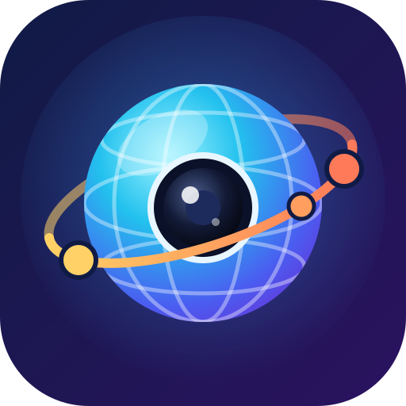

<p align="center"></p>

# PhotoSphère

Traitement et organisation de photosphères, pensé pour la **Samsung Gear 360**.
Application web installable (PWA) qui fonctionne sur ordinateur comme sur smartphone, hors connexion, sans aucune dépendance.

## Fonctions

- **Import** depuis la carte micro SD (fichiers ou dossier `DCIM/100PHOTO`, glisser-déposer), ou depuis la galerie du téléphone.
- **Conversion** en équirectangulaire **7776 × 3888**, ou **7200 × 3600** comme le logiciel Samsung (réglable) :
  - les photos brutes **double fisheye** de la Gear 360 (2016 : 7776 × 3888, 2017 : 5472 × 2736) sont détectées et assemblées, avec la même orientation que le logiciel Samsung ;
  - **calibrage automatique** de chaque photo : alignement des deux objectifs sur la zone de recouvrement, **correction du vignettage** (bords des objectifs plus sombres, profil mesuré sur la Gear 360 et cohérent avec le logiciel Samsung, sans saturer le ciel), **égalisation de l’exposition** le long de la couture, **correction de parallaxe** le long de la couture (les objets proches, vus sous un angle légèrement différent par chaque objectif, sont recalés) et **couture optimale** qui passe là où les deux images concordent. Réglages manuels possibles dans l’éditeur ;
  - les photos déjà assemblées (application Samsung) sont remises à la bonne taille ;
  - le JPEG produit contient les métadonnées **XMP GPano** (reconnu comme photosphère par Google Photos, Facebook, les visionneuses VR…) et conserve l’EXIF d’origine (date, GPS).
- **Redressement** des photos prises de travers : curseurs de bascule avant/arrière et gauche/droite **relatifs à la vue affichée**, cap (rotation horizontale qui ne modifie pas le redressement), bouton **✨ Auto (verticales)** qui détecte les bords verticaux des murs, portes et meubles et redresse la photo (refusé au-delà de 15°, signe de verticales mal détectées ; « Défaire » pour annuler), ou outils en cliquant **2 points de l’horizon** ou **1 à 2 lignes verticales**. Grille et vue à plat pour vérifier.
- **Nord** : points cardinaux sur l'horizon de l'éditeur ; « Indiquer le nord » puis un clic dans l'image règle le cap.
- **Défaire** (bouton ou Ctrl+Z) la dernière action de l'éditeur ; renommage des photos directement dans la bibliothèque.
- **Sélection multiple** dans la bibliothèque (cases à cocher, Maj + clic pour une plage, Ctrl + clic sur une vignette, « Tout sélectionner ») et **traitements par lot** : redressement automatique, calcul du relief (IA), suppression, avec bilan par photo.
- **Manuel utilisateur** (bouton « 📖 Manuel », et bouton 📖 dans chaque panneau qui ouvre la bonne section) : les panneaux ne gardent qu'une ligne d'explication.
- **Recherche** d'une photo par son nom (ou son nom de fichier), sans tenir compte des majuscules ni des accents : bibliothèque, choix des liens, liste de la visionneuse.
- **Liens** : destination choisie dans une grille de vignettes avec recherche (taille réglable, Ctrl + molette) ; **vue d'arrivée** réglable par lien (par défaut, on arrive dos au lien qui ramène à la photo d'où l'on vient) ; raccourci **« ↩ Lien retour »** pour placer le lien qui revient (par ex. sur la porte vue depuis la pièce). Un clic sur un lien de l'image le sélectionne et fait défiler la liste jusqu'à lui ; **Ctrl + glisser** le déplace.
- **Liens** entre photos : on touche l’endroit (porte, passage) qui mène à une autre photo ; lien retour créé automatiquement.
- **Visionneuse** (bouton ✏ Éditer pour redresser la photo affichée ou y ajouter un lien, puis revenir au même endroit) :
  - *Tactile* : doigt / souris, pincer ou molette pour zoomer ;
  - *Bout de bras* : on bouge le téléphone (gyroscope) ;
  - *Casque VR* : écran partagé avec correction des lentilles (k1, k2 ; préréglages Cardboard v1 / v2, RAZ) et écartement réglable des centres des deux images, pour casques type Cardboard ; **relief** (effet 3D) réglable, calculé en temps réel pour chaque œil selon la direction regardée, d'après une carte de profondeur calculée par intelligence artificielle dans le navigateur (Depth Anything V2 Small, licence Apache 2.0, via ONNX Runtime Web : WebGPU ou WebAssembly ; modèle téléchargé une fois depuis Hugging Face puis gardé en cache) : murs, sol, plafond, meubles et personnes avec leurs contours. Onglet « Relief » de l'éditeur pour la calculer, la vérifier (couleurs des distances) et régler la hauteur de l'objectif ; on fixe un lien 1,5 s pour y aller (ou bouton du casque) ;
  - *WebXR* natif quand le navigateur le propose.
- **Plan** des photos (nord en haut), en sphères orientables (Ctrl + glisser) ou en rectangles ; chaque lien part de son point de contact dans la photo, que l'on peut faire glisser. « 🔗 Relier » ou déposer une photo sur une autre crée deux liens automatiques réciproques ; déplacer une photo réoriente ces liens. Un clic sur une photo l’affiche 5 fois plus grande avec son nom modifiable. Photos non placées rangées dans une zone à part : glissées sur le plan, elles y restent même sans lien (à relier plus tard). Plan sur fond blanc avec **éditeur de dessin** : traits des murs (accrochés aux extrémités et à l'horizontale / verticale ; un trait ou une extrémité se déplace en le faisant glisser, les murs raccordés suivant), textes (noms de pièces), gomme et Défaire ; le dessin est enregistré dans le fichier de réglages. Les liens restent visibles en transparence là où ils passent sur une photo.
- **Parcours partagé** : on partage le dossier des photos d'origine (OneDrive, clé, carte SD…) avec `photosphere.json` et le sous-dossier `photosphere-relief` ; la personne le visualise avec PhotoSphère (« 🔗 Parcours partagé ») sans rien importer : ouverture immédiate, photos liées préchargées, pleine définition, rien de conservé en sortant. Le dossier de travail y range les cartes de relief tout seul ; sinon, export « 📦 Parcours à partager ». (Lien OneDrive direct : à venir, avec connexion Microsoft.)
- **Dossier de travail** (PC, Chrome / Edge) : PhotoSphère lit les photos du dossier d'origine et y enregistre automatiquement `photosphere.json` ; option pour renommer aussi le fichier d'une photo quand on la renomme.
- **Visionneuse** : les cibles des liens n'apparaissent, progressivement, qu'à l'approche de la souris ou du regard ; sur PC, la souris devient une flèche orientée vers la cible la plus proche.
- **Fichier de réglages** `photosphere.json` (≈ 11 ko par photo) : à ranger avec les photos d'origine, jamais modifiées. En réimportant le dossier (ou les photos avec ce fichier), redressement, nord, calibrage, liens et noms sont retrouvés.
- **Exports** : visite autonome en un seul fichier `.html` (s’ouvre partout, même en local), ZIP des JPEG, sauvegarde/restauration du projet pour passer du PC au téléphone.

## Et le Bluetooth ?

La Gear 360 n’utilise le Bluetooth que pour l’appairage et la télécommande : les photos passent ensuite par **Wi-Fi Direct** avec un protocole propriétaire Samsung, inaccessible depuis un navigateur. Deux solutions : la carte micro SD (meilleure qualité), ou transférer avec l’application Samsung Gear 360 puis importer depuis la galerie.

## Utilisation

Publication automatique sur GitHub Pages à chaque push sur `main` (activer *Settings → Pages → Source : GitHub Actions*). Sur le téléphone, ouvrir le site puis « Ajouter à l’écran d’accueil ».

En local :

```sh
npm start            # http://localhost:8080/
npm test             # tests unitaires (maths, JPEG, ZIP, EXIF/XMP)
npm run test:browser # test de bout en bout dans Chromium (nécessite playwright)
```

Le gyroscope et WebXR exigent une page servie en HTTPS (ou `localhost`).

## Architecture

| Fichier | Rôle |
| --- | --- |
| `src/app.js`, `src/ui.js` | Bibliothèque, file de conversion, navigation |
| `src/importer.js` | Import, détection fisheye / équirectangulaire |
| `src/calibrate.js` | Calibrage automatique : objectifs, exposition, tracé de la couture |
| `src/exporter.js`, `src/jpeg-encoder.js`, `src/jpeg-worker.js` | Rendu WebGL par tuiles et encodage JPEG par bandes (pas de canvas géant : compatible iPhone) |
| `src/shaders.js`, `src/gl-source.js` | Projection fisheye → équirectangulaire, redressement, rendu de la vue |
| `src/renderer.js`, `src/controls.js`, `src/player.js` | Visionneuse (perspective, plat, stéréo, WebXR, gyroscope, liens) |
| `src/editor.js` | Redressement, calibrage, liens |
| `src/depth.js` | Relief : assemblage des vues analysées par l’IA en carte de profondeur 360°, mise à l’échelle par le sol |
| `src/depth-ai.js` | Relief : chargement du modèle de profondeur (ONNX Runtime Web) et analyse de la photo |
| `src/parcours.js` | Parcours partagé : lecture à la demande d'un dossier (photos d'origine + réglages + reliefs), préchargement, mémoire de session |
| `src/relief-files.js` | Noms des cartes de relief rangées avec les photos (`photosphere-relief/`) |
| `src/batch.js` | Traitements par lot depuis la bibliothèque (redressement automatique, relief) sur un rendu hors écran |
| `src/manual.js` | Manuel utilisateur (fenêtre avec sommaire, ouverte à la bonne section depuis chaque panneau) |
| `src/autolevel.js` | Redressement automatique : détection des bords verticaux, estimation robuste de la verticale |
| `src/math.js` | Rotations, orientation du téléphone, calculs d’horizon/verticales |
| `src/metadata.js`, `src/zip.js`, `src/tour-export.js`, `src/db.js` | EXIF/XMP, ZIP, exports, stockage IndexedDB |
